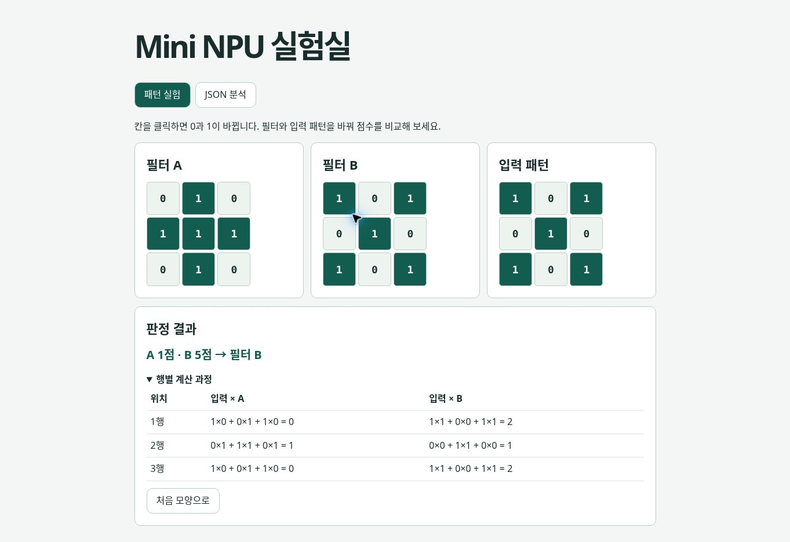
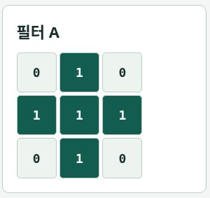
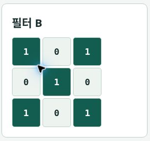
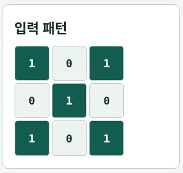
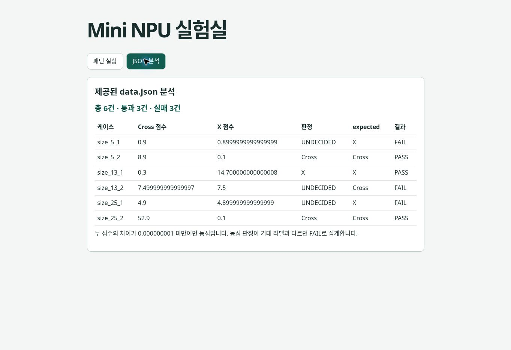

# Mini NPU Simulator

그림을 숫자 행렬로 표현하고 두 필터 중 어느 쪽에서 더 높은 점수가 나오는지 확인하는 Python 콘솔 프로그램이다.

## 학습목표

- 십자가와 X를 2차원 배열로 표현하고, 반복문으로 같은 위치의 값을 곱해 누적하는 MAC 함수를 구현한다.
- JSON 키에서 패턴 크기를 읽고, 필터와 입력의 크기를 검증한 뒤 라벨을 표준화해 판정 결과를 채점한다.
- 손계산과 프로그램 출력을 대조해 입력 형식, 계산 로직, 부동소수점 비교 중 어디에서 결과 차이가 생겼는지 진단한다.
- 필터 크기별 MAC 시간을 10회 측정해 평균을 구하고, 연산 횟수와 실측 시간의 관계를 해석한다.

## 실행 화면



입력 X는 필터 B와 다섯 칸이 겹친다. 아래 행별 계산표에서 B의 점수 5가 어떻게 나왔는지 확인할 수 있다(2 + 1 + 2).

| A · 십자가 필터 | B · X 필터 | C · 입력 패턴 |
|:---:|:---:|:---:|
|  |  |  |
| C와 가운데 한 칸이 겹쳐 **1점** | C와 다섯 칸이 겹쳐 **5점** | 같은 입력 C를 A, B에 각각 적용해 **B로 판정** |

<details>
<summary>JSON 분석 결과 6건 보기</summary>



</details>

## 브라우저에서 실험하기

저장소에서 **Code → Download ZIP**을 선택하고 압축을 푼 뒤 `index.html`을 더블클릭한다. 별도 설치 없이 오프라인에서도 실행할 수 있다.

1. 처음 화면에서 십자가 필터 A와 X 필터 B가 입력 X에 각각 1점과 5점을 주는지 확인한다.
2. 입력 X의 모서리 네 칸을 차례로 끈다. 가운데 칸만 남으면 두 필터가 모두 1점을 얻는다. 아래의 행별 계산표에서 바뀐 곱셈 항을 확인한다.
3. **JSON 분석** 탭에서 제공 데이터 6건의 두 점수와 기대 라벨을 비교한다. 웹 버전은 배포 시점 데이터를 내장하며, 다른 데이터로 실험할 때는 콘솔 버전의 data.json을 교체한다.

## 콘솔 실행 방법

Python 3.8 이상에서 압축을 풀고, VS Code로 해당 폴더를 연 다음 터미널에서 실행한다. 추가 패키지 설치는 필요 없다.

```bash
python main.py
```

- **1번 · 사용자 입력** — 필터 A, 필터 B, 패턴 순서로 각각 세 줄을 입력한다. 각 줄은 공백으로 구분한 숫자 세 개다. 잘못 입력한 행만 다시 입력하면 된다.
- **2번 · JSON 분석** — main.py와 같은 폴더에 있는 data.json을 읽는다. 압축 파일에는 제공된 원본을 이 이름으로 포함했다. 각 케이스의 점수와 판정, 성능 표, 전체 집계를 차례로 출력한다.

### 3×3 예제

1번을 선택한 뒤 아래 아홉 줄을 순서대로 붙여 넣는다. 처음 세 줄은 십자가 필터, 다음 세 줄은 X 필터, 마지막 세 줄은 X 패턴이다.

```text
0 1 0
1 1 1
0 1 0
1 0 1
0 1 0
1 0 1
1 0 1
0 1 0
1 0 1
```

A 점수는 1.0, B 점수는 5.0이므로 판정은 B다. 마지막 세 줄을 십자가로 바꾸면 5.0 대 1.0으로 A가 된다. 모두 0을 넣으면 두 점수가 0.0으로 같아 판정 불가가 출력된다.

## 구현 요약

각 행렬은 중첩 리스트에 저장한다. 행과 열의 개수 및 숫자 형식을 검증한 뒤, mac 함수가 같은 위치의 두 값을 곱해 누적한다. 3×3 X 패턴은 X 필터와 다섯 칸이 겹치고 십자가 필터와는 중심 한 칸만 겹친다. 가중치가 실수이면 각 위치의 기여도도 실수가 된다.

패턴 키 `size_N_idx`에서 N은 행렬 한 변의 크기, idx는 같은 크기 안에서 패턴을 구분하는 번호다. 예를 들어 `size_13_2`는 두 번째 13×13 입력이고, `filters.size_13`의 두 필터 모두와 비교한다.

### 한 필터의 점수는 어떻게 만들어지는가?

```python
def mac(pattern, kernel):
    total = 0.0
    for row, weights in zip(pattern, kernel):
        for value, weight in zip(row, weights):
            total += value * weight
    return total
```

바깥쪽 `zip`은 입력과 필터의 같은 행을, 안쪽 `zip`은 그 행에서 같은 열의 두 값을 짝짓는다. X 입력과 X 필터의 첫 행은 모두 `[1, 0, 1]`이다. 세 칸을 차례로 처리하면 누적값은 1 → 1 → 2가 된다. 둘째 행까지 처리하면 3, 마지막 행까지 처리하면 5가 되어 `return total`이 5.0을 반환한다. 같은 입력을 십자가 필터에 적용하면 가운데 한 칸만 기여해 1.0이 된다.

### JSON 키는 어느 필터를 가리키는가?

아래는 `batch()`에서 필터 선택과 점수 계산에 쓰이는 줄을 발췌한 것이다. 실제 함수는 키 형식, 필터 존재 여부, 항목 형식도 검사한다.

```python
match = re.fullmatch(r"(size_([1-9][0-9]*))_[0-9]+", key)
group = match[1]
pattern = matrix(case.get("input"), int(match[2]), "patterns.{}.input".format(key))
pair = filters[group]
a, b = mac(pattern, pair["Cross"]), mac(pattern, pair["X"])
```

| `size_5_1`을 처리하는 순서 | 코드에서 얻는 값 |
|---|---|
| 키를 두 부분으로 읽는다 | `match[1]`은 필터 묶음 이름 `size_5`, `match[2]`는 한 변의 길이 `"5"`다. 끝의 `_1`은 같은 크기 안의 케이스 번호다. |
| 입력 크기를 검증하고 필터를 고른다 | `matrix(..., 5, ...)`가 5행과 각 행의 5열을 확인한다. `filters["size_5"]`에서 Cross와 X 필터를 꺼낸다. |
| 두 점수로 판정한 뒤 정답과 대조한다 | 0.9와 0.8999999999999999의 차이는 허용오차 미만이어서 `UNDECIDED`다. 파일의 정답 `x`를 정규화한 `X`와 달라 `[tie]`로 집계한다. |

### 라벨 정규화와 확장 절차

`normalize()`는 필터 키와 기대 라벨을 읽는 두 곳에서 같은 변환표를 사용하도록 분리했다. 공백을 제거하고 소문자로 바꾼 뒤 `+`, `cross`는 `Cross`로, `x`는 `X`로 변환한다. 이 함수 하나만 호출해 표기별 반환값과 미등록 라벨의 오류를 독립적으로 테스트할 수 있다.

1. **정규화 규칙 추가** — 예를 들어 십자가의 별칭 `plus`를 허용하려면 `normalize()`의 변환표에 `"plus": "Cross"`를 추가한다. 기존 도형의 별칭은 내부 판정 라벨을 그대로 쓴다.
2. **판정 범위 확인** — 삼각형처럼 새로운 도형 자체를 지원하려면 크기별 필터를 추가하고, 두 필터 전용 검증과 점수 계산을 전체 후보에 적용하도록 바꾼다. 최고점과 차점의 차이로 동점을 판정하고 출력에도 새 도형을 포함한다.
3. **테스트 케이스 추가** — 별칭의 단독 변환을 확인한 뒤 JSON 복사본에서 필터 키와 expected에 각각 새 표기를 넣는다. 기존 PASS 사례의 판정이 유지되는지, 미등록 표기가 있는 건만 FAIL인지 확인한다. 새 도형이라면 단독 최고점과 공동 최고점 사례도 추가한다.
4. **문서화** — 허용 표기, 표준 라벨, 예제 입력과 기대 결과를 README에 기록한다. 웹 실험실에도 적용할 경우 내장 데이터와 JavaScript 변환 규칙을 함께 갱신한다.

### 두 모드의 동점 규칙

두 모드 모두 `decide()`에서 **절대 점수 차이**가 `1e-9` 미만이면 동점으로 처리한다. 정확히 경계값이면 높은 점수를 선택한다. 제공 데이터에서 십진수로 같은 점수를 float로 누적할 때의 차이는 약 10⁻¹⁶~10⁻¹⁵이고, 구별되는 두 점수의 차이는 최소 8.8점이다. 이 범위에서 과제의 절대 허용오차는 반올림 차이를 흡수하면서 구별되는 결과를 보존한다. 덧셈마다 반올림이 일어날 수 있어 누적 순서를 바꾸면 마지막 자릿수가 달라질 수 있다.

| 모드 | 동점 표시 | 채점 |
|---|---|---|
| 1 · 사용자 입력 | 판정 불가 (UNDECIDED) | 기대 라벨을 받지 않으므로 점수와 판정만 표시한다. |
| 2 · JSON 분석 | UNDECIDED | expected는 Cross 또는 X이므로 동점은 FAIL이며, 요약에 케이스 이름과 동점 사유를 남긴다. |

## 결과 리포트

Linux x86_64, Python 3.12.14에서 저장소의 `data.json`으로 모드 2를 실행한 결과는 총 6건, PASS 3건, FAIL 3건이다. 아래 점수는 비교 전 Python에서 출력한 값이다.

| 케이스 | Cross 점수 | X 점수 | 판정 | 정규화한 정답 | 결과 |
|---|---:|---:|---|---|---|
| size_5_1 | 0.9 | 0.8999999999999999 | UNDECIDED | X | FAIL |
| size_5_2 | 8.9 | 0.1 | Cross | Cross | PASS |
| size_13_1 | 0.3 | 14.700000000000008 | X | X | PASS |
| size_13_2 | 7.499999999999997 | 7.5 | UNDECIDED | Cross | FAIL |
| size_25_1 | 4.9 | 4.899999999999999 | UNDECIDED | X | FAIL |
| size_25_2 | 52.9 | 0.1 | Cross | Cross | PASS |

### 콘솔 실행 기록

Python 3.12.14에서 `python main.py`로 두 모드를 각각 실행했다. 시간은 해당 실행의 실측값이다.

**모드 1 · 직접 입력.** 위 3×3 예제의 아홉 줄을 입력한 뒤 나온 결과다.

```text
A 점수: 1.0 | B 점수: 5.0
두 필터 연산 시간: 0.004707 ms
판정: B

성능 분석 (필터 1개, 크기별 10회 평균)
크기       평균 시간(ms)    MAC 횟수(N²)
3×3	0.000919	9
```

**모드 2 · JSON 분석.** 메뉴에서 2를 선택하면 같은 크기의 두 패턴도 서로 다르게 판정될 수 있다. 첫 두 케이스의 실제 출력은 다음과 같다.

```text
[size_5_1]
Cross 점수: 0.9 | X 점수: 0.8999999999999999
판정: UNDECIDED | expected: X | FAIL: [tie] 허용오차 내 동점 (판정 UNDECIDED, expected X)

[size_5_2]
Cross 점수: 8.9 | X 점수: 0.1
판정: Cross | expected: Cross | PASS
```

<details>
<summary>모드 2 전체 출력 보기 · 필터 로드부터 실패 케이스 목록까지</summary>

```text
size_5 필터 로드 완료 (Cross, X)
size_13 필터 로드 완료 (Cross, X)
size_25 필터 로드 완료 (Cross, X)

[size_5_1]
Cross 점수: 0.9 | X 점수: 0.8999999999999999
판정: UNDECIDED | expected: X | FAIL: [tie] 허용오차 내 동점 (판정 UNDECIDED, expected X)

[size_5_2]
Cross 점수: 8.9 | X 점수: 0.1
판정: Cross | expected: Cross | PASS

[size_13_1]
Cross 점수: 0.3 | X 점수: 14.700000000000008
판정: X | expected: X | PASS

[size_13_2]
Cross 점수: 7.499999999999997 | X 점수: 7.5
판정: UNDECIDED | expected: Cross | FAIL: [tie] 허용오차 내 동점 (판정 UNDECIDED, expected Cross)

[size_25_1]
Cross 점수: 4.9 | X 점수: 4.899999999999999
판정: UNDECIDED | expected: X | FAIL: [tie] 허용오차 내 동점 (판정 UNDECIDED, expected X)

[size_25_2]
Cross 점수: 52.9 | X 점수: 0.1
판정: Cross | expected: Cross | PASS

성능 분석 (필터 1개, 크기별 10회 평균)
크기       평균 시간(ms)    MAC 횟수(N²)
3×3	0.000910	9
5×5	0.001570	25
13×13	0.006383	169
25×25	0.022323	625

총 테스트: 6 | 통과: 3 | 실패: 3
- size_5_1 [tie] 허용오차 내 동점 (판정 UNDECIDED, expected X)
- size_13_2 [tie] 허용오차 내 동점 (판정 UNDECIDED, expected Cross)
- size_25_1 [tie] 허용오차 내 동점 (판정 UNDECIDED, expected X)
```

</details>

### 실패 원인 분석

1. 모든 패턴 키가 대응하는 필터를 가리켰고, 여섯 입력의 행·열 수가 해당 크기와 일치했다.
2. 정답에 쓰인 + 세 건과 x 세 건은 각각 Cross와 X로 변환됐다. 따라서 표기 차이로 인한 실패는 0건이다.
3. 원본의 십진수를 표준 라이브러리 Decimal로 별도 재계산하면 세 실패 케이스는 각각 정확히 동점이다.
4. size_5_1은 두 필터 모두 0.9점이다. 입력 라벨은 X지만 두 필터의 가중합만으로 X를 선택할 근거가 없다.
5. size_13_2는 양쪽 모두 7.5점이다. float로 누적할 때 Cross 점수가 조금 작게 표현된다.
6. size_25_1은 양쪽 모두 4.9점이다. 단순 대소 비교를 적용하면 표현 오차 때문에 Cross가 선택된다.
7. epsilon 정책은 이처럼 계산 순서와 이진 실수 표현에서 생기는 작은 차이를 동점으로 처리한다.
8. 세 동점 모두 기대 라벨은 특정 모양이므로 채점 규칙에 따라 FAIL이다. 판정 함수는 정답 라벨을 참조하지 않는다.
9. 나머지 세 건은 두 점수 차이가 epsilon보다 크고 높은 쪽이 정답과 일치했다.

### 성능 측정과 시간 복잡도

동일한 규칙으로 생성한 십자가와 X 행렬을 사용해 크기별로 MAC 함수 한 번의 시간을 10회 측정하고 평균을 냈다. 단위는 밀리초이며, 입력·출력·파일 읽기·행렬 생성은 측정 구간 밖에서 수행했다.

| 크기 | 평균 시간(ms), 실행 예 | 필터당 MAC 횟수 |
|---|---:|---:|
| 3×3 | 0.000910 | 9 |
| 5×5 | 0.001570 | 25 |
| 13×13 | 0.006383 | 169 |
| 25×25 | 0.022323 | 625 |

- 한 행에 N개 값이 있고 행도 N개이므로 한 필터의 곱셈·누적은 정확히 N²회다. 시간 복잡도는 O(N²)이다.
- 판정 하나는 필터 두 개를 사용하므로 2N²회다. 25×25 패턴 하나를 분류할 때는 1,250회다.
- 5×5에서 25×25로 한 변이 5배가 되면 연산 횟수는 25배, 이번 실측 평균 시간은 약 14.2배가 된다.
- 짧은 실행에서는 함수 호출 및 타이머 비용도 평균에 포함된다. 실행 환경에 따라 시간 비율은 달라지며 연산 횟수는 일정하다.
- 저장된 행렬 하나는 O(N²) 공간을 사용한다. MAC 함수는 곱셈 결과 행렬을 별도로 만들지 않아 추가 공간은 O(1)이다.

### CPU와 NPU에서 병목이 달라지는 이유

이 Python 구현은 CPU에서 한 칸씩 순서대로 처리한다. 작은 행렬에서는 반복문과 함수 호출 비용이 눈에 띄고, 큰 행렬에서는 입력과 필터를 메모리에서 반복해서 읽는 비용도 커질 수 있다. CPU도 SIMD 명령과 여러 코어로 병렬 계산할 수 있지만, 여기서는 Python 반복문 하나를 측정했다.

NPU는 여러 MAC 연산기를 동시에 사용해 서로 다른 칸이나 필터의 곱을 병렬로 계산한 뒤 부분합을 합친다. 연산기에 값을 충분히 공급하지 못하면 메모리 대역폭과 데이터 전송이 병목이 된다. 큰 입력이나 여러 필터를 처리할 때는 행렬을 작은 블록으로 나눠 가까운 메모리에 둔 입력을 재사용할 수 있다. 위 표는 CPU에서 실행한 Python 함수의 실측값이며, NPU 하드웨어의 속도는 별도로 측정해야 한다.

### 오류 처리 재현

- 모드 1에서 첫 행에 `1 0` 또는 `a b c`를 입력하면 같은 행의 입력 안내가 다시 나온다.
- data.json 복사본에서 size_5_1의 input 마지막 행을 지우고 size_5_2의 첫 행에서 값 하나를 지운다. 복사본과 main.py를 같은 별도 폴더에 두고 2번을 실행하면 각각 행·열 오류가 기록되며, 전체 집계는 6건 중 통과 2건, 실패 4건이다.

### 출력 읽기

모드 1에서 X 예제를 입력하면 `A 점수: 1.0 | B 점수: 5.0`과 `판정: B`가 출력된다. **두 필터 연산 시간**은 한 입력에 A와 B를 한 번씩 적용한 시간이고, **성능 표의 평균 시간**은 한 필터에 MAC을 10번 적용해 구한 1회 평균이다.

| 실패 사유 | 확인할 내용 |
|---|---|
| `[tie]` | 두 점수 차이가 허용오차 미만이다. 제공 데이터의 FAIL 3건이 여기에 해당한다. |
| `[mismatch]` | 점수 차이는 허용오차 이상이지만 높은 쪽이 기대 라벨과 다르다. 입력, 필터 가중치, 기대 라벨을 함께 확인한다. |
| `[invalid]` | 입력이나 필터의 형식, 라벨 또는 수치 범위를 확인한다. 예를 들어 `patterns.size_5_1.input (2행 3열)`은 해당 입력의 위에서 두 번째 줄, 왼쪽에서 세 번째 값이다. |

직접 입력에서 `0 abc 1`을 넣으면 해당 행의 2열과 문제 값 `'abc'`가 표시된다. 올바른 세 숫자를 다시 입력하면 앞서 저장한 행부터 이어서 계산한다. JSON 파일 자체의 문법이 깨진 경우에는 파일 경로와 줄·열을 표시한다.

## 과제를 마치면 설명할 수 있는 것

| 스스로 답해 볼 질문 | 이 프로젝트로 설명하는 예 |
|---|---|
| MAC은 무엇이고 AI에서는 어디에 쓰일까? | 입력값과 가중치를 하나씩 곱해 합계에 더하는 연산이다. 신경망에서도 여러 입력의 가중합을 구할 때 이 계산을 반복한다. |
| 화면의 X는 왜 필터 B로 판정될까? | 입력 C와 십자가 A는 중심 한 칸이 겹쳐 1점이다. X 필터 B는 행별로 2점, 1점, 2점을 얻어 총 5점이다. 네 모서리를 끄면 양쪽 모두 중심만 남아 1 대 1 동점이 된다. |
| `size_13_2`와 정답 `+`는 어떻게 읽을까? | 13×13 입력 중 2번 케이스이므로 `size_13`의 두 필터를 사용한다. 정답 `+`와 필터 키 `cross`를 모두 `Cross`로 바꿔 같은 도형을 같은 이름으로 비교한다. |
| 점수가 조금 다른데 왜 동점일까? | `size_5_1`의 두 점수는 십진수로 모두 0.9다. float로 누적하면 한쪽이 0.8999999999999999가 된다. 절대 차이가 `1e-9` 미만이므로 두 모드 모두 동점으로 처리한다. JSON 모드에서는 기대 라벨 X와 달라 FAIL이다. |
| FAIL이 나오면 무엇부터 확인할까? | 키·행렬 크기·라벨을 확인한다. 형식이 맞으면 작은 입력을 손으로 계산해 코드의 두 점수와 대조한다. 점수까지 맞으면 기대 라벨과 동점 규칙을 확인한다. 제공 데이터의 FAIL 3건은 모두 이 마지막 단계에서 설명된다. |
| 필터 한 변이 5에서 25로 늘면 연산량과 시간은 어떻게 달라질까? | 필터당 MAC은 25회에서 625회로 25배가 된다. N행의 각 행에서 N칸을 방문하므로 시간 복잡도는 O(N²)이다. 실제 시간은 함수 호출과 타이머 비용도 포함하므로 10회 평균이 정확히 25배일 필요는 없다. |
| NPU는 이 계산을 어떻게 병렬화할까? | 여러 연산기가 서로 다른 칸이나 필터의 곱을 동시에 계산하고 부분합을 합친다. 연산기를 늘려도 입력과 가중치를 제때 공급하지 못하면 메모리 대역폭이 병목이 된다. |
